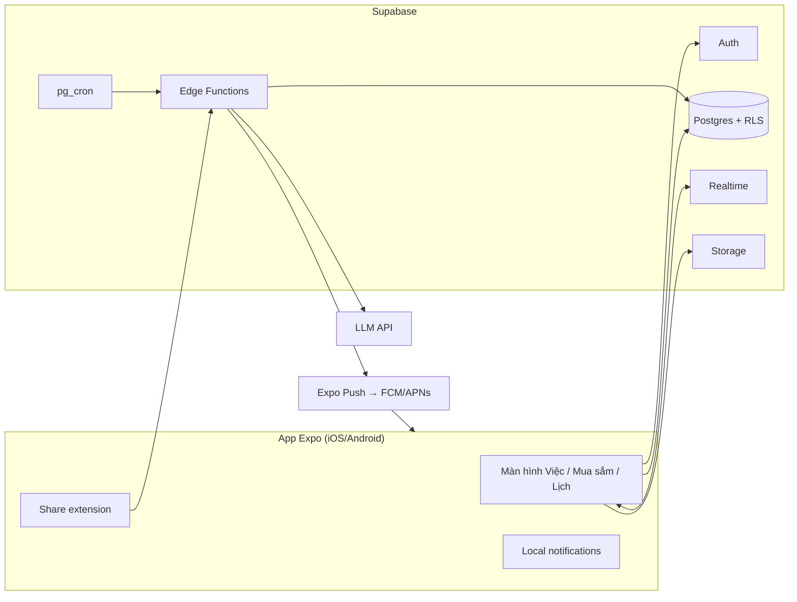

# Architect — Review kiến trúc v1

## Summary (≤5 lines)
- Hướng chính **giữ nguyên**: Expo + Supabase là lựa chọn đúng với kỹ năng, chi phí và quy mô (hàng trăm đến hàng nghìn hộ).
- Có 6 điểm cần sửa trước khi code. Hai điểm quan trọng nhất: data model đang khóa cứng 2 thành viên, và chat realtime đầy đủ là phần đắt nhất nhưng giá trị không rõ.
- Đề xuất bỏ mã hóa đầu-cuối khỏi MVP. Thêm **share extension** và **AI parsing** làm điểm khác biệt.
- Chi phí: 0 đ khi dogfood; khoảng 1–3 triệu VND/tháng khi có 10.000 hộ.

## Key decisions & rationale
Ưu tiên chất lượng theo thứ tự: (1) tốc độ ship với 6–8 h/tuần, (2) độ tin cậy của nhắc việc, (3) quyền riêng tư dữ liệu gia đình.

## Assumptions made
Giai đoạn đầu dưới 1.000 hộ; không có yêu cầu lưu dữ liệu tại Việt Nam. Theo Nghị định 13 về dữ liệu cá nhân, cần kiểm tra lại khi lên store.

## Risks / open questions for the lead
- Quyết định giữ hay bỏ chat thuộc về owner (xem Decision log).

---

## Đánh giá từng thành phần v1

| # | Thành phần v1 | Đánh giá | Đề xuất |
| --- | --- | --- | --- |
| 1 | `household_members` giới hạn 2 người bằng constraint | Khóa đường mở rộng; sau này gỡ ra rất tốn công vì chạm vào RLS, UI và luồng mời | Cho phép N thành viên kèm `role` (`owner`/`partner`/`helper`) ngay từ đầu; UI vẫn chỉ hiển thị 2 người |
| 2 | Chat realtime đầy đủ (ảnh, voice, đã xem) | Phần tốn công nhất: media, push mỗi tin, typing, đã xem, phân trang. Lại phải cạnh tranh với Zalo | MVP: **bình luận trên task + "nudge"**. Nhận việc từ Zalo qua share sheet. Chat đầy đủ chỉ làm khi số liệu beta đòi hỏi |
| 3 | Ghi chú chung mã hóa đầu-cuối, chia khóa qua QR | Mất máy là mất khóa, cần cơ chế backup khóa; phức tạp gấp nhiều lần lợi ích ở giai đoạn này | Hoãn lại. Dùng RLS + mã hóa at-rest của Postgres; nhãn "riêng tư" chỉ ẩn nội dung khỏi push |
| 4 | Việc lặp lại dạng RRULE + pg_cron quét mỗi phút | Ổn, nhưng nếu sinh sẵn mọi lần lặp thì bảng phình to và khó sửa | Chỉ sinh **lần kế tiếp** khi lần hiện tại xong hoặc quá hạn. Lưu `timezone` của hộ; tính giờ nhắc theo `Asia/Ho_Chi_Minh` |
| 5 | Offline queue tự viết | Dễ sinh bug xung đột khi cả hai cùng sửa một task | Optimistic update qua TanStack Query, last-write-wins theo `updated_at`, đổi trạng thái idempotent. Chỉ cân nhắc PowerSync khi offline thật sự là vấn đề |
| 6 | Push qua Expo Push | Ổn. Thiếu log và cơ chế thử lại; nhắc việc mà không đến là mất niềm tin ngay | Bảng `notification_log` lưu ticket/receipt của Expo, retry, đánh dấu token chết. Local notification làm dự phòng cho nhắc việc của chính máy đó |

### Bổ sung mới
- **Share extension** (iOS Share Extension, Android `ACTION_SEND`) dùng `expo-share-intent`: chia sẻ một tin nhắn Zalo vào app thì app tạo nháp task. Đây là cầu nối với nơi người dùng đã đang nhắn tin. Lưu ý: cần dev build, không chạy được trên Expo Go.
- **AI parsing tiếng Việt**: Edge Function gọi LLM với structured output `{title, assignee, due_at, rrule, checklist[]}`. Có fallback bằng rule đơn giản ("tối nay", "thứ 6") khi API lỗi. Ghi log chi phí theo hộ. Đây cũng là phần portfolio AI Engineering.
- **Entitlements**: bảng `household_plans(household_id, plan, expires_at)` để sau này bật Premium bằng RevenueCat mà không phải đổi schema.

## Kiến trúc đề xuất (v2)



### Data model v2 (thay đổi so với v1)
- `household_members`: bỏ giới hạn 2 người, thêm `role`.
- `tasks`: thêm `updated_at`, `deleted_at` (soft delete), `next_occurrence_of` (task gốc của việc lặp lại).
- `task_comments`: thay cho `messages` trong MVP.
- `notification_log`: `id, user_id, task_id, expo_ticket_id, status, error, sent_at`.
- `household_plans`: phục vụ monetization sau này.
- `ai_requests`: `household_id, input_tokens, output_tokens, cost_usd, created_at`, để theo dõi chi phí.

### Luồng rủi ro nhất: nhắc việc
```mermaid
sequenceDiagram
  participant C as pg_cron (mỗi phút)
  participant F as Edge Function send-reminders
  participant D as Postgres
  participant E as Expo Push
  C->>F: trigger
  F->>D: SELECT reminders WHERE remind_at <= now() AND sent_at IS NULL FOR UPDATE SKIP LOCKED
  F->>E: gửi theo batch (≤100/lần)
  E-->>F: tickets
  F->>D: cập nhật sent_at và notification_log
  Note over F,D: Job khác sau 15 phút đọc receipt; DeviceNotRegistered thì xóa token
```

## Security — threat model rút gọn (STRIDE)
| Mối đe dọa | Chỗ xảy ra | Biện pháp |
| --- | --- | --- |
| Spoofing: dò mã mời 6 số | Ghép đôi | Mã dùng một lần, hết hạn 24h, rate-limit 5 lần/giờ/user; cân nhắc mã 8 ký tự chữ+số |
| Information disclosure: lộ dữ liệu hộ khác | Mọi bảng | RLS + test pgTAP chạy trong CI; Storage riêng tư, đọc bằng signed URL |
| Information disclosure: nội dung hiện trên màn hình khóa | Push | Chế độ push riêng tư |
| Tampering / prompt injection | AI parsing | LLM chỉ trả JSON theo schema; validate bằng Zod; không cho LLM gọi tool hay ghi DB trực tiếp |
| Elevation: lộ service key | Edge Functions | Secret chỉ để trong Supabase; app chỉ có anon key |
| Supply chain | CI | Dependabot/Snyk, `npm audit`, pin phiên bản, EAS build từ CI |

## Cost (ước tính, kiểm tra lại giá khi đăng ký)
| Hạng mục | Dogfood | 10.000 hộ |
| --- | --- | --- |
| Supabase | Free | Pro ~25 USD + usage |
| Expo EAS | Free | Free/Starter |
| Apple / Google | 99 USD/năm · 25 USD một lần | như cũ |
| LLM | <1 USD | ~40–60 USD (chỉ hộ trả phí) |
| **Tổng/tháng** | **~8 USD** | **~40–100 USD** |

## ADRs
1. **Expo + Supabase thay vì tự viết backend NestJS/AWS.** Lý do: ship nhanh, RLS và Realtime có sẵn. Hệ quả: lock-in vừa phải, nhưng Postgres chuẩn nên xuất dữ liệu được. Phương án thay thế: Firebase (NoSQL khó làm thống kê), AWS Amplify (nặng).
2. **N thành viên/hộ ngay từ schema.** Đổi về sau rất đắt; làm ngay chỉ tốn thêm khoảng 1 giờ.
3. **Hoãn E2E encryption.** Rủi ro mất khóa cao hơn lợi ích; xem lại khi có người dùng ngoài yêu cầu.
4. **Bình luận trên task thay cho chat MVP.** Chờ owner xác nhận.

## Evolution path
| Cái gì hỏng trước | Tín hiệu | Bước tiếp |
| --- | --- | --- |
| Kết nối Realtime | >500 kết nối đồng thời (giới hạn gói) | Lên Pro; chỉ subscribe khi app đang mở |
| pg_cron quét reminders | Job chạy >10 giây | Index `(remind_at) WHERE sent_at IS NULL`; tách ra queue (pgmq) |
| Chi phí LLM | >30% doanh thu | Cache, dùng model nhỏ hơn, rule-based trước, LLM sau |
| Xung đột offline | Bug report về mất dữ liệu | PowerSync/ElectricSQL |
